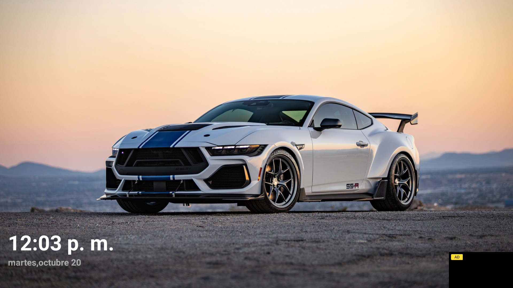
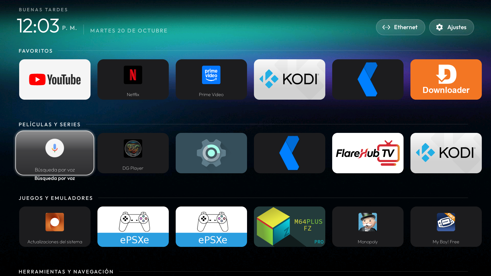

# CleanYourTV - TVBox Edition 🚀📺

  

  
  
  
  

**CleanYourTV - TVBox Edition** es un launcher nativo ultra ligero, libre de publicidad y de altísimo rendimiento, adaptado específicamente para dispositivos **Android TV Box** (Amlogic S905X3, Allwinner, Rockchip, etc.) y Smart TVs con Android 9+.

Combina la elegancia y ligereza minimalista de **CleanYourTV** con la organización por carruseles horizontales categorizados inspirada en **Projectivy Launcher**.

---

## 🌟 Características Destacadas

| Función | Descripción |
|---|---|
| ⚡ **Ultra Ligero** | El APK compilado pesa solo **301 KB** y consume apenas **~108 MB de RAM**. Ideal para equipos con 1 GB o 2 GB de RAM. |
| 🏎️ **Máxima Fluidez (60 FPS)** | Diseñado para respuesta instantánea al control remoto: animaciones de enfoque a **90 ms**, física de resortes con rigidez `1200f` y aceleración por hardware forzada. |
| 🗂️ **Carruseles Horizontales** | Organización automática en filas horizontales independientes: **Favoritos**, **Películas y Series**, **Juegos y Emuladores**, **Herramientas** y **Sistema**. |
| 📱 **Soporte Dual Leanback + Mobile** | Detecta tanto aplicaciones oficiales de TV como apps móviles instaladas por APK (sideload) sin perder ninguna de vista. |
| 🌌 **Backdrop Dinámico Aurora** | Fondo con gradientes sutiles y resplandor ambiental (*ambient glow*) en tiempo real adaptado a la paleta de colores de la app enfocada. |
| 🚫 **Cero Publicidad / Bloatware** | Sin recomendaciones forzadas, sin anuncios de Google ni rastreo de fabricantes. |

---

## 📸 Capturas de Pantalla

| Vista Principal (Favoritos & Glow Ambiental) | Exploración por Categorías (Películas / Juegos / Apps) |
|:---:|:---:|
|  |  |

---

## 📥 Descarga e Instalación

### 1. Descarga Directa
Puedes descargar el instalador APK listo para usar desde la sección de lanzamientos:
👉 **[Descargar CleanYourTV-TVBox.apk](https://github.com/hugoa970-coder/CleanYourTV-TVBox/releases)** *(Solo 301 KB)*

### 2. Instalación en tu TV Box
1. Copia el archivo `CleanYourTV-TVBox.apk` en una memoria USB o descárgalo directamente en tu TV Box con una app como **Downloader** o cualquier explorador de archivos.
2. Abre el archivo e instálalo permitiendo "Orígenes desconocidos".
3. Presiona el botón **Home** de tu control remoto y selecciona **CleanYourTV** como launcher predeterminado ("Siempre").

---

## 🛠️ Tecnologías y Optimizaciones

- **Lenguaje:** Java 100% nativo (AndroidX).
- **Physics Engine:** `SpringAnimation` de AndroidX Dynamicanimation calibrado a `STIFFNESS_VERY_HIGH (1200f)` con amortiguación `DAMPING_RATIO_NO_BOUNCY`.
- **Pre-caching de paletas:** Los colores de resplandor ambiental se generan y almacenan en memoria para evitar tirones de GPU o caídas de frames al desplazar el cursor.
- **Shared RecycledViewPool:** Reutilización eficiente de vistas entre los carruseles horizontales.
- **Resolución universal de paquetes:** Implementación de `QUERY_ALL_PACKAGES` y resolución combinada de `CATEGORY_LEANBACK_LAUNCHER` + `CATEGORY_LAUNCHER`.

---

## 📋 Requisitos del Sistema

- **Dispositivo:** TV Box Android, Smart TV o Fire TV Stick.
- **Versión de Android:** Android 5.0 (Lollipop / API 21) en adelante (probado y optimizado en Android 9 Pie y Android 11).
- **Procesadores compatibles:** Amlogic (S905X, S905X3, S905X4), Realtek, MediaTek, Allwinner, Rockchip.

---

## 🤝 Créditos y Agradecimientos

Este proyecto es una adaptación y evolución especializada basada en el trabajo original de [GZ-G / CleanYourTV](https://github.com/GZ-G/CleanYourTV), extendido con carruseles horizontales categorizados y optimizaciones de latencia para Android TV Boxes por [@hugoa970-coder](https://github.com/hugoa970-coder).

---

## 📄 Licencia

Este proyecto está bajo la Licencia **MIT** - consulta el archivo [LICENSE](LICENSE) para más detalles.
